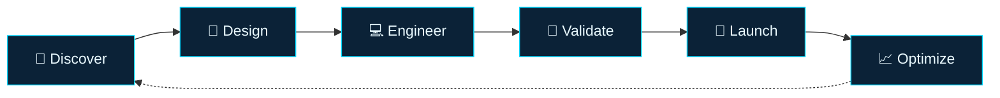
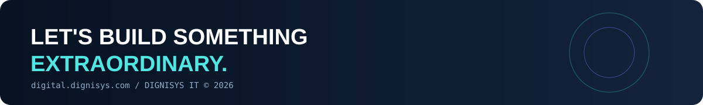

  

## `>_` WHO WE ARE

**Dignisys IT** engineers digital products for ambitious businesses — from beautiful customer experiences to reliable enterprise infrastructure. We bring **product thinking, scalable architecture, performance and security** into every stage of delivery.

<table>
<tr>
<td align="center" width="25%"><h3>⚡</h3><b>FAST</b> Performance-first</td>
<td align="center" width="25%"><h3>🧩</h3><b>SCALABLE</b> Built to grow</td>
<td align="center" width="25%"><h3>🛡️</h3><b>SECURE</b> Security by design</td>
<td align="center" width="25%"><h3>🚀</h3><b>FUTURE-READY</b> Modern architecture</td>
</tr>
</table>

## `01 /` WHAT WE CREATE

<table>
<tr>
<td width="50%" valign="top">

### 🌐 Digital Experiences
**High-performance websites & web apps**

Next.js · React · TypeScript · Tailwind CSS

Modern interfaces, responsive experiences, SEO-friendly rendering and accessible design.

</td>
<td width="50%" valign="top">

### 🏢 Enterprise Platforms
**Dashboards, SaaS & HRM systems**

Admin portals · Role-based access · Workflows

Complex business operations, simplified into intuitive digital products.

</td>
</tr>
<tr>
<td width="50%" valign="top">

### 🔗 APIs & Data
**Reliable backend foundations**

Node.js · Express · REST APIs · PostgreSQL · MongoDB

Maintainable integrations, dependable data flows and modular services.

</td>
<td width="50%" valign="top">

### ☁️ Cloud & Delivery
**Infrastructure built for production**

Docker · Nginx · GitHub Actions · CI/CD

Repeatable deployments, secure configurations and streamlined release pipelines.

</td>
</tr>
</table>

## `02 /` OUR ENGINEERING TOOLKIT

**THE FRONTEND LAB**

**BACKEND & DATA**

**SHIP & SCALE**

## `03 /` FROM IDEA TO IMPACT

Thoughtful strategy. Clean execution. Continuous improvement.

## `04 /` OUR ENGINEERING PRINCIPLES

> **Build for people. Architect for scale. Deliver with confidence.**

- **Performance is a feature** — optimized experiences, efficient APIs and fast delivery.
- **Security is foundational** — responsible authentication, access control and infrastructure practices.
- **Quality is continuous** — clear code, testing, reviews and automation.
- **Discoverability matters** — technical SEO, semantic markup and rendering strategy.
- **Maintainability wins** — modular systems that teams can confidently extend.

## `05 /` LET'S BUILD SOMETHING EXCEPTIONAL

  

© 2026 Dignisys Digital · Crafted with purpose. Engineered for impact.

