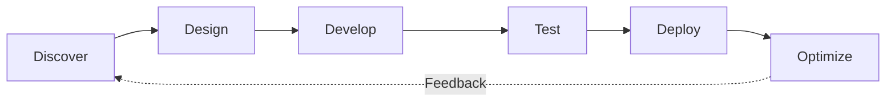

# 

### Enterprise Software Development · Digital Transformation · Cloud Engineering

**From ideas to production-ready digital products.**

---

## ✨ Who We Are

At **Dignisys IT**, we design, develop, and optimize modern digital platforms for businesses. Our work spans enterprise web applications, intuitive dashboards, reliable API services, and performance-focused digital experiences.

> **Our approach:** Build for today. Architect for tomorrow. Improve continuously.

<table>
<tr>
<td width="50%" valign="top">

### 💻 What We Build
- 🌐 **Web Applications** — responsive, accessible, scalable experiences
- 📊 **Enterprise Platforms** — SaaS portals, dashboards, and HRM solutions
- 🔗 **APIs & Integrations** — maintainable REST services and workflows
- ☁️ **Cloud & DevOps** — deployment pipelines and infrastructure

</td>
<td width="50%" valign="top">

### 🎯 What We Prioritize
- ⚡ **Performance** — fast, efficient user experiences
- 🔐 **Security** — sound authentication and data practices
- 🧩 **Maintainability** — modular architecture and clean code
- 🔎 **Discoverability** — technical SEO and search-friendly rendering

</td>
</tr>
</table>

---

## 🛠️ Our Technology Toolbox

**Frontend & Languages**

**Backend & Databases**

**Infrastructure & Workflow**

---

## 🚀 How We Deliver

We focus on thoughtful architecture, practical engineering, automated delivery, and ongoing improvements after launch.

---

## 📈 Engineering in Motion

<!-- Replace YOUR_GITHUB_ORG with the actual GitHub organization username to enable these dynamic cards. -->
<!--

-->

## 🌍 Let's Connect

**Have a project in mind?** [Explore Dignisys Digital](https://digital.dignisys.com/)

© 2026 Dignisys Digital · Built with care and curiosity.

