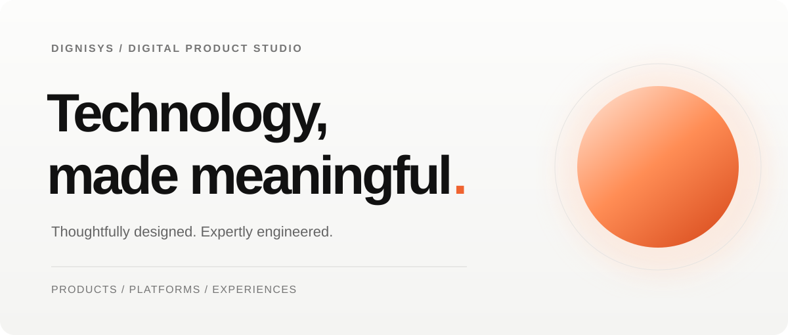
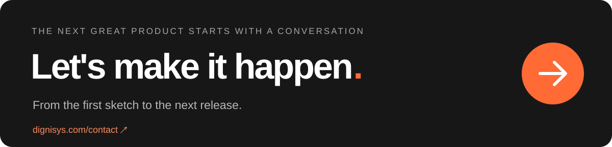

 
 

 
 

**Thoughtful products. Beautiful experiences. Dependable engineering.**

Product engineering & digital studio · Mumbai · Chandigarh · Worldwide

 
 

 

 

---

 

## A studio for what’s next.

<table cellpadding="14"><tr><td width="55%" valign="top">

**A product studio for companies that need technology to work.**

Dignisys is a product engineering and digital studio with teams in **Mumbai and Chandigarh, India**, working with founders, growing businesses and established teams in India and internationally.

We bring together **designers, software engineers and marketers** to deliver mobile apps, custom business software, SaaS platforms, websites and the design, search, marketing and support that help them grow.

**Our mission:** Make technology matter: turn business needs into products that are useful on day one and remain easy to change years later.

We focus on the real-world details that matter after launch: weak network connections, password resets, integrations, future releases and the team that maintains the product next year.

[Meet Dignisys →](https://dignisys.com/about/)

</td><td width="45%" valign="top">

</td></tr></table>

### Our working principles

| Principle | What it means |
|---|---|
| **Understand before prescribing** | Learn the business goals, users and constraints before recommending technology. |
| **Make decisions visible** | Document scope, risks, dependencies, responsibilities and trade-offs. |
| **Build for the next team** | Deliver maintainable code, tests, documentation and accessible interfaces. |
| **Plan beyond launch** | Think about support, changes, performance and ownership from the start. |

 

---

 

## One team. Every possibility.

Start with the capability you need now, then add design, development, growth or support as the product evolves.

### Product engineering · 01—04

<table cellpadding="14">
<tr><td width="50%" valign="top">

#### 01 · [Product development](https://dignisys.com/solutions/product-development/)

Turn a business idea into a focused first release and continue improving it. Discovery, research, requirements, prototypes, architecture, MVP planning, development and iteration.

</td><td width="50%" valign="top">

#### 02 · [Mobile app development](https://dignisys.com/solutions/mobile-app-development/)

iOS and Android applications designed for real devices, variable connectivity and long-term upkeep. Native and cross-platform development, integrations, testing and releases.

</td></tr>
<tr><td valign="top">

#### 03 · [Custom software development](https://dignisys.com/solutions/software-development/)

Internal tools, operational dashboards, enterprise portals, APIs, integrations and workflow systems designed around how teams actually work.

</td><td valign="top">

#### 04 · [SaaS development](https://dignisys.com/solutions/saas-development/)

Subscription software and multi-tenant platforms with account onboarding, permissions, billing, administration and architecture designed for future growth.

</td></tr>
</table>

### Websites & content · 05—08

<table cellpadding="14">
<tr><td width="50%" valign="top">

#### 05 · [Websites and CMS](https://dignisys.com/solutions/websites-and-cms/)

Fast, accessible, responsive business websites with content structures and editing workflows that teams can maintain independently.

</td><td width="50%" valign="top">

#### 06 · [WordPress development](https://dignisys.com/solutions/wordpress-development/)

Custom themes, Gutenberg and Elementor builds, WooCommerce, plugin reviews, structured content and careful website migrations.

</td></tr>
<tr><td valign="top">

#### 07 · [Webflow development](https://dignisys.com/solutions/webflow-development/)

Component-based Webflow websites, reusable CMS templates, responsive pages and marketing-friendly publishing workflows.

</td><td valign="top">

#### 08 · [Framer development](https://dignisys.com/solutions/framer-development/)

Design-led landing pages, brand websites and product-launch experiences with polished motion and fast publishing cycles.

</td></tr>
</table>

### Design & growth · 09—12

<table cellpadding="14">
<tr><td width="50%" valign="top">

#### 09 · [UI/UX design](https://dignisys.com/solutions/ui-ux-design/)

User research, journey mapping, information architecture, wireframes, clickable prototypes, usability testing and development-ready design systems.

</td><td width="50%" valign="top">

#### 10 · [Digital marketing](https://dignisys.com/solutions/digital-marketing/)

Paid search, social campaigns, content programmes, analytics and conversion-focused marketing measured against meaningful business outcomes.

</td></tr>
<tr><td valign="top">

#### 11 · [SEO, AEO and GEO](https://dignisys.com/solutions/seo/)

Technical SEO, crawlability, site architecture, structured data, content visibility and optimization for traditional search and AI-assisted discovery.

</td><td valign="top">

#### 12 · [Maintenance and support](https://dignisys.com/solutions/maintenance/)

Application and website updates, dependency and security reviews, monitoring, QA, bug fixes and ongoing product improvements.

</td></tr>
</table>

**Explore the complete service catalogue:** [dignisys.com/solutions](https://dignisys.com/solutions/)

 

---

 

## Clarity, from day one.

### Clear decisions. Visible progress. No surprises.

Four stages guide delivery from the first conversation to post-launch improvement.

<table cellpadding="14"><tr><td width="56%" valign="top">

**01 — Understand the problem**

We speak with users and stakeholders, review what exists, define goals and success measures, and identify risks and unknowns.

**02 — Agree the plan**

We document and agree the prioritised scope, architecture, milestones, costs and trade-offs before building.

**03 — Build in the open**

Work progresses in two-week cycles, with a working demo at the end of each cycle, a shared project board and weekly written updates.

**04 — Launch and keep improving**

We release carefully, monitor usage, address issues, and provide a documented handover or continue as the product team.

</td><td width="44%" valign="top">

</td></tr></table>

### What you can expect at every stage

| Stage | Key outputs |
|---|---|
| Understand | Goals, success measures, stakeholder notes, risk and unknowns register |
| Plan | Prioritised scope, architecture note, milestones and estimate |
| Build | Fortnightly demos, shared board, weekly updates and documented decisions |
| Launch | Release checklist, monitoring, alerts, documentation and handover |

Scope changes are logged, assessed for their cost and schedule impact, and approved in writing before implementation.

[Read our full delivery approach →](https://dignisys.com/how-we-work/)

 

---

 

## Work together. Your way.

| Engagement | Best suited for | How it works |
|---|---|---|
| **01 · Discovery sprint** | An idea or problem without a defined scope | Fixed-price, **2–4 weeks** of workshops, research and prototyping. Produces prioritised scope, architecture notes and an estimate. |
| **02 · Defined build** | A known first-release scope | Milestone-based delivery with a dedicated team, two-week cycles, demos, a shared board and documented change control. |
| **03 · Ongoing product team** | A live product needing steady improvement | Monthly retainer, stable team capacity, shared roadmap, support and agreed response times. |

 

---

 

## Built for the real world.

<table cellpadding="10">
<tr><td width="33%" valign="top"> <b>Logistics & supply chain</b> Dispatch, tracking, warehouse and driver tools designed for challenging networks.</td><td width="33%" valign="top"> <b>Maritime & fleet</b> Reliable crew, vessel, fleet and operations systems.</td><td width="33%" valign="top"> <b>Digital marketplaces</b> Two-sided platforms, payments, onboarding and trust workflows.</td></tr>
<tr><td valign="top"> <b>Public sector</b> Accessible citizen services and procurement-conscious internal tools.</td><td valign="top"> <b>Education & learning</b> Learning platforms, training portals and course-management tools.</td><td valign="top"> <b>Immersive & creative tech</b> Interactive experiences, AR and VR supported by dependable engineering.</td></tr>
</table>

 

---

 

## Technology with purpose.

We choose technology around product requirements, existing systems, team skills and maintainability—not trends alone.

**WEB & FRONTEND**

 
 

**MOBILE**

 
 

**BACKEND & DATA**

 
 

**CLOUD, CMS & DESIGN**

 

**Additional platforms:** Webflow · Framer

 

---

 

## Details make the difference.

- **Transparent communication:** a shared project board, weekly written progress reports and working demos every two weeks during delivery.
- **Controlled scope:** clear estimates, documented trade-offs and written approval for changes.
- **Ownership:** clients receive source code, designs and documentation under the website's stated payment and ownership terms.
- **Remote collaboration:** work with clients in India, the Middle East, Europe, the US and Australia, with agreed meeting overlap.
- **Confidentiality:** mutual NDAs available before sensitive project details are shared.
- **After launch:** choose continued product development, maintenance and support, or a documented handover to an internal team.

 

---

 

## Thinking out loud.

Practical guidance from the people doing the design and engineering.

| Topic | Read |
|---|---|
| **CMS selection** | [WordPress, Webflow or Framer: choose the editing workflow first](https://dignisys.com/insights/wordpress-webflow-or-framer/) |
| **Mobile architecture** | [Native or cross-platform? Start with the awkward requirements](https://dignisys.com/insights/native-vs-cross-platform/) |
| **Product strategy** | [Your MVP needs a boundary, not another feature](https://dignisys.com/insights/what-to-build-in-your-mvp/) |
| **All articles** | [Explore Dignisys insights](https://dignisys.com/insights/) |

 

---

 

## The things you want to know.

<b>Can we start with just an idea?</b>
 Yes. A discovery sprint helps define the problem, validate priorities, explore prototypes and produce a build-ready scope and estimate.

<b>Can you improve an existing product?</b>
 Yes. We can review existing code, infrastructure, usability and analytics, then prioritise what to fix, improve or leave unchanged.

<b>How long does a project take?</b>
 It depends on user roles, integrations, complexity, platform and content readiness. The website notes that a focused first release often takes eight to sixteen weeks; discovery provides a project-specific estimate.

<b>How will we track progress?</b>
 Through a shared project board, written weekly updates, working demos every two weeks and recorded decisions.

<b>Who owns the source code and designs?</b>
 The client, subject to the agreed contract and payment terms. The website states that code lives in a client-controlled repository and the relevant intellectual property is assigned after related invoices are paid.

<b>Do you sign NDAs?</b>
 Yes. A mutual NDA can be arranged before confidential information is shared.

<b>What happens after launch?</b>
 Continue with an ongoing product team, choose a maintenance arrangement or transition to your own developers with a planned handover.

[More answers on our website →](https://dignisys.com/)

 

---

 

## What will we make together?

<table cellpadding="14"><tr><td width="58%" valign="top">

### Have something to build or fix?

Tell us what you're working on, who it serves, and what you need to change. We welcome early ideas, defined builds and existing products that need a better next release.

**Dignisys aims to respond to enquiries within one business day.**

- [Start a project](https://dignisys.com/contact/)
- [Explore all services](https://dignisys.com/solutions/)
- [Learn how we work](https://dignisys.com/how-we-work/)
- [Message us on WhatsApp](https://wa.me/919930127193)

</td><td width="42%" valign="top">

</td></tr></table>

 

 
 

© 2026 Dignisys Digital · Product engineering and digital experiences.

