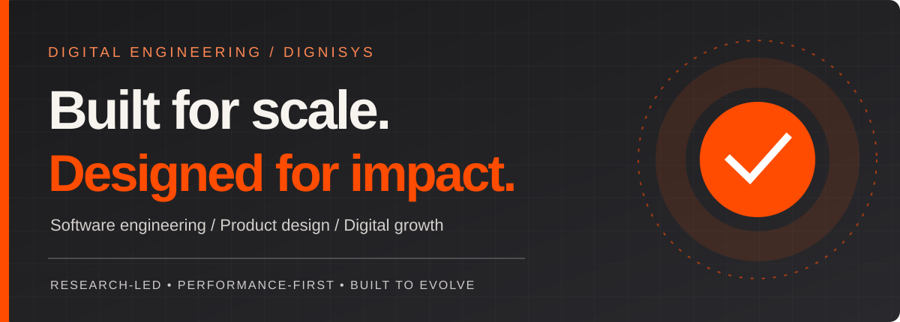
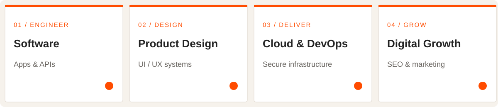
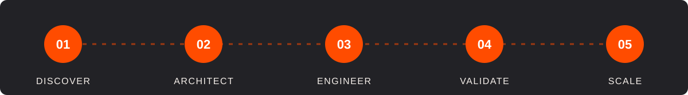

  

  

  

 

## What we believe

> Technology should do more than work. It should solve real problems, support ambitious teams, and create measurable business impact.

**Dignisys** brings together software engineering, digital product design, infrastructure and growth strategy. We turn ideas and complex business requirements into dependable web platforms, business applications, and modern digital experiences.

 

## Our capabilities

| 01 — SOFTWARE ENGINEERING | 02 — PRODUCT EXPERIENCE |
|:--|:--|
| **Enterprise software, web apps & APIs.** From responsive websites to scalable SaaS platforms, management dashboards, integrations, and data-driven systems. | **UI/UX and digital product design.** Research-led user journeys, design systems, responsive interfaces, prototyping, and intuitive workflows. |
| **03 — CLOUD & DELIVERY** | **04 — DIGITAL GROWTH** |
| **Cloud, DevOps & performance.** Secure deployments, infrastructure automation, containerization, testing, and performance engineering. | **SEO, digital marketing & optimization.** Technical SEO, search-ready architecture, analytics and conversion-focused improvements. |

 

## Technologies behind our work

**FRONTEND & EXPERIENCE**

  

**BACKEND & DATA**

  

**CLOUD, DEVOPS & PRODUCT**

 

## How we work

Our delivery approach is grounded in business understanding, purposeful architecture, clean engineering, structured validation, and continuous improvement.

 

## What matters to us

**Clarity over complexity.** Systems should be understandable, maintainable and useful.

**Performance by design.** Fast interfaces, resilient services and production-ready delivery.

**Security as a foundation.** Thoughtful authentication, access controls and infrastructure practices.

**Business outcomes first.** Every design and engineering decision should serve a real need.

 

 

  
© 2026 Dignisys Digital · Built for scale. Designed for impact.

