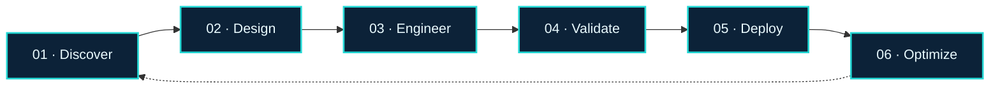

 

  

 

**We turn complex business challenges into elegant, scalable digital products.**

---

## THE DIGNISYS DIFFERENCE

<table>
<tr>
<td width="25%" align="center"><strong>01 — THINK</strong> Product-led strategy</td>
<td width="25%" align="center"><strong>02 — DESIGN</strong> Interfaces that connect</td>
<td width="25%" align="center"><strong>03 — ENGINEER</strong> Systems built to last</td>
<td width="25%" align="center"><strong>04 — EVOLVE</strong> Continuous optimization</td>
</tr>
</table>

Dignisys IT is a software engineering and digital transformation company building high-performance experiences and dependable infrastructure. We combine **modern product design, full-stack engineering, security, performance, and technical SEO** to help businesses grow.

## WHAT WE BUILD

<table>
<tr>
<td width="50%" valign="top">

### ◈ Digital Products
**Websites · Web applications · Digital experiences**

Next.js, React, TypeScript and Tailwind CSS.

High-performance interfaces, responsive design, accessible experiences and search-friendly delivery.

</td>
<td width="50%" valign="top">

### ◈ Enterprise Systems
**SaaS · HRM · Dashboards · Admin portals**

Modular applications, role-based authorization, operational workflows, and management platforms.

</td>
</tr>
<tr>
<td width="50%" valign="top">

### ◈ Backend & APIs
**Business logic · Integrations · Data architecture**

Node.js, Express, REST APIs, PostgreSQL and MongoDB.

Maintainable service layers designed for reliable business operations.

</td>
<td width="50%" valign="top">

### ◈ Cloud & Delivery
**Docker · Nginx · CI/CD · Deployment**

Containerized services, secure configurations, release automation and production-focused infrastructure.

</td>
</tr>
</table>

## OUR TECHNOLOGY DNA

**FRONTEND / EXPERIENCE**

 

**BACKEND / DATA**

 

**INFRASTRUCTURE / WORKFLOW**

## HOW WE SHIP

> **The goal isn't just to ship software. It's to create technology that keeps delivering value.**

## OUR ENGINEERING VALUES

- **Performance from day one** — speed, rendering strategy and Core Web Vitals.
- **Security by design** — authentication, permissions and responsible infrastructure.
- **Clean architecture** — modular code, maintainable services and scalable foundations.
- **Quality through iteration** — testing, reviews, monitoring and continuous delivery.
- **Business-first outcomes** — digital solutions built around real user needs.

---

 

  
© 2026 Dignisys Digital · Engineering what's next.

